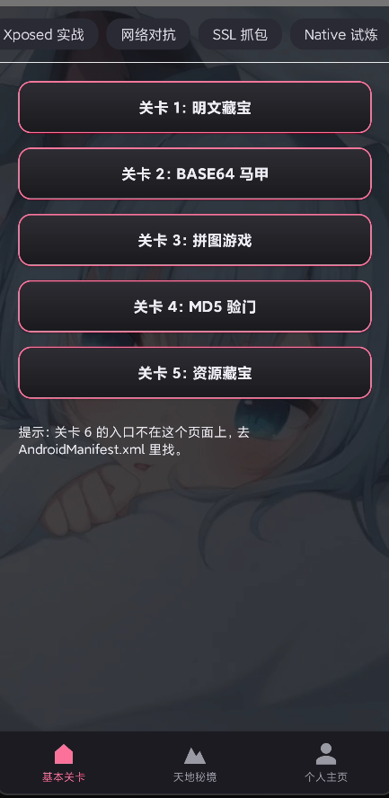

# FatdogReverse

**An offline Android reverse-engineering challenge range · 110 levels · fully local · reproducible answers**

-3DDC84)


> **English** · [简体中文](README.zh-CN.md)

FatdogReverse is a **fully offline** Android reverse-engineering practice range. It turns the whole attack/defence surface — Java/DEX static analysis, Smali patching, Frida, Xposed, protocol reversing, cryptography, HTTPS/mTLS, native reversing, anti-debugging, code-integrity checks, unpacking, VMPs and signature-check bypass — into a single progressive, level-by-level route.

One design rule drives everything: **all level data, keys and verification logic live only in the local `server.py` — the APK contains none of them.** Every level is therefore reproducible from `APK + this repo` alone, with no online service and no real app sample.



> For local study, research, and security testing on devices you own or are authorized to test.

---

## Table of Contents

- [Features](#features)
- [Level Overview](#level-overview)
- [Quick Start](#quick-start)
- [Traffic Interception Setup](#traffic-interception-setup)
- [Project Structure](#project-structure)
- [How Levels Work](#how-levels-work)
- [Spoiler Files](#spoiler-files)
- [FAQ](#faq)
- [Disclaimer & License](#disclaimer--license)

---

## Features

**Data lives entirely on the backend.** Numbers, keys and some flags are generated only by `server.py`; they do not exist in the APK. Network levels require the server to be running, and the server verifies signatures, a time window and tamper state.

**Offline and reproducible.** Nothing reaches out to the internet. The server uses a self-signed CA; certificates, keys and seeds all ship with the repo — `python server.py` reproduces the entire chain.

**The full attack/defence chain is covered.** From "a plaintext flag in a string" all the way to "OLLVM control-flow flattening + modified crypto + packed-shell unpacking". Difficulty ramps by star rating, so the range suits systematic practice rather than isolated puzzles.

**Anti-cheat is baked in.** Many levels hide **near-miss decoy keys** (one character off), **same-shaped function clones**, **fake pins**, and **poisoning** (when hooking/tampering is detected, one byte is silently flipped so every signature is wrong with no error shown). Copying strings out of the code usually does *not* give the right answer.

**Every level is multi-solution and verifiable.** Most levels support both a **static re-implementation** track and a **dynamic hooking** track; the write-ups ship complete Python re-implementation scripts and byte-for-byte comparison samples, so you can verify your own work.

**A story runs through the levels.** Clearing a level unlocks its chapter in the built-in web-novel reader (*Home → Forbidden Land*). Volume 1 (L1–L20) ships as `app/assets/novel/L1.txt … L20.txt`.

**No Android Studio required.** A single `build_apk.py` drives `aapt2` / `d8` (R8) / `zip` / `zipalign` / `apksigner` and produces a signed APK in minutes.

---

## Level Overview

There are **110 levels**, split into a main track and a "Secret Realms" (天地秘境) block.

| ID | Count | Content |
|---|---:|---|
| `L1–L53` + `L37b` | 54 | Main track, advanced by hall category |
| `KL1–KL55` | 50 | Secret Realms (`KL31–KL35` planned, not yet open) |
| `KKL1–KKL5` | 5 | 太玄之初 addendum (packer-eradication & VMP signing chain) |
| `KL40b` | 1 | 碧落天 addendum (Flutter engine certificate-check stub) |
| **Total** | **110** | |

### Main track `L1–L53` (+`L37b`)

| Category | Levels | Count | Focus |
|---|---|---:|---|
| Static analysis | `L1–L6` | 6 | Plaintext, encoding, string recovery, digests, resource files, hidden Activity |
| Smali patching | `L7–L9`, `L20` | 4 | Smali branches & arrays, logic chains, complex state machines, repack to flip a switch |
| Frida hooking (Java layer) | `L10–L14` | 5 | `MessageDigest`, `Mac`, `Cipher`, multi-layer transforms, decoy classes |
| Network protocols | `L15–L19` | 5 | HMAC signing, RC4, SM4/SM3 (Chinese GM), RSA/DES, AES + R8 obfuscation |
| TLS / interception | `L21–L27` | 7 | TrustManager, CertificatePinner, WebView SSL error, anti-hook guard, JNI gate, mTLS |
| Native trials | `L28–L37`, `L37b` | 11 | String encryption, dynamic registration, pointer dispatch, cross-layer calls, anti-debug, CRC self-check, modified MD5 |
| Xposed in action | `L38–L42` | 5 | Hook return values, tamper arguments, read private fields, replace method bodies, persistence |
| Signature-check bypass | `L43–L47` | 5 | SigningInfo, native digest sink, APK self-parsing, certificate-derived keys, grand finale |
| Native continent | `L48–L53` | 6 | C++ name mangling, STL containers, vtables, templates, EH control flow, modified crypto, **JNI reverse calls (native → Java instance methods / `NewObject`)** |

> `L6` has no entry button — it hides inside `AndroidManifest.xml` and you have to find it.

### Secret Realms `KL1–KL55` / `KKL1–KKL5` / `KL40b`

Unlocked after clearing the whole main track, or entered directly with the passphrase `Fatdog` at the gate.

| Region | Levels | Count | Focus |
|---|---|---:|---|
| Kunlun | `KL1–KL5` | 5 | Native basics, dynamic registration, six-`so` relay (dual-type callbacks), diamond-fork six-`so` (four callback kinds) + anti-emulator checks, flattened dispatcher six-`so` (five callbacks + three probes, must be traced) |
| Flowing Sand River | `KL6–KL10` | 5 | Modified AES / DES / SM4 / RC4 / SHA-256, five consecutive levels (C++ OOP, RAII, overloads, virtual dispatch) |
| Nether Sea | `KL11–KL15` | 5 | SO-patch countermeasures: static patch, dynamic patch, anti-patch, multi-SO cross-validation |
| Primordial Taixuan | `KL16–KL20` | 5 | Packed-shell unpacking by generation. **Currently a maintenance page**: the submission value is shown directly and entering it marks the level cleared (kept so the hall/skill table stays intact) |
| Taixuan addendum | `KKL1–KKL5` | 5 | Progressive packer-eradication on real DEX (2/4/6/10/15 DEX): gen-1 split-payload packer (RC4+base64), gen-2 in-memory loader (AES-CBC), the three-step unpacking method (multi-DEX + parent delegation + method-body extraction), multi-class shell + stack-based VM (AES-CTR), three-layer shell-in-shell + in-memory VM (SM4-CBC + AES-CTR) |
| Fusang Tree | `KL21–KL28` | 8 | Frida detection & anti-detection: ports, fd, `maps`, `auxv`, `ptrace`, timing |
| Pavilion of Heaven's Secrets | `KL29–KL30` | 2 | Custom TLV and Protobuf binary protocol reversing |
| Biling Heaven | `KL36–KL40` | 5 | Real Flutter/Dart reversing: AOT snapshot (Blutter), `--obfuscate` obfuscation, BoringSSL pinning, `dart:ffi`, interception-environment countermeasures |
| Biling addendum | `KL40b` | 1 | Flutter engine-layer certificate-check stub (reFlutter-equivalent patch) + RC4 stream cipher / plain digest |
| Sumeru Realm | `KL41–KL45` | 5 | H5/WebView reversing: JSBridge, resource encryption, JS-layer crypto recovery, protocol replay |
| Nine Nether | `KL46–KL50` | 5 | Root detection & bypass: environment integrity, bootloader, mount namespace, Play Integrity simulation |
| Maze Array | `KL51–KL55` | 5 | OLLVM obfuscation countermeasures: control-flow flattening, bogus control flow, string encryption, indirect jumps, modified crypto |

> `KL31–KL35` (Pavilion extension: gRPC / GraphQL) is still on the drawing board and is **not** counted in the current 110.

---

## Quick Start

### Requirements

| Component | Version |
|---|---|
| JDK | 17 or newer |
| Android SDK | Platform 34 + Build Tools 34.0.0 |
| NDK | 26.1.10909125 (needed by some native levels) |
| Python | 3.9+ |

Prepare as needed for solving: `jadx`, `apktool`, `frida` / `frida-server`, Xposed or LSPosed, `mitmproxy`, Charles Proxy, IDA / Ghidra / unidbg.

### Step 1 — Start the server

```bash
python -m pip install fastapi uvicorn python-multipart pycryptodome cryptography
```

If `certs/` is missing (common right after cloning), generate the TLS and mTLS certificates first:

```bash
python gen_certs.py
```

Then start it:

```bash
python server.py
```

The server listens on three ports and prints each level's seed and data check value in its startup log.

### Step 2 — Build the APK

```bash
python build_apk.py
```

The output is `FatdogReverse.apk` in the repo root. The build script auto-detects your SDK / JDK / NDK paths, so there is nothing to configure by hand.

### Step 3 — Install

```bash
adb install -r FatdogReverse.apk
```

> If an older build signed with a different key is already installed, uninstall it first. **Uninstalling clears local progress.**

### Step 4 — Point the app at the server

On an emulator this is automatic: the app reaches the host through `10.0.2.2`.

On a physical device, `127.0.0.1` means the phone itself, so reverse-map the ports from your computer to the phone:

```bash
adb reverse tcp:8787 tcp:8787
adb reverse tcp:8443 tcp:8443
adb reverse tcp:8444 tcp:8444

adb reverse --list    # confirm the mappings are active
```

Port mappings are lost when you unplug USB, reboot the phone, restart ADB or reboot the computer — re-run them when needed.

You can also edit `server.api_base_url` in `app/assets/config.json` to your computer's LAN address so the phone connects over the same Wi-Fi (open the matching firewall ports).

---

## Traffic Interception Setup

<details>
<summary>Click to expand: port topology, certificate roles and Charles configuration</summary>

### Ports and protocols

| Port | Protocol | Levels |
|---|---|---|
| `8787` | HTTP | `L15–L19`, `KKL1–KKL5` |
| `8443` | HTTPS | `L21–L25`, `L27–L37`, `L37b`, `L43–L53`, `KL6–KL10`, `KL30`, `KL36–KL40`, `KL40b`, `KL51–KL55` |
| `8444` | HTTPS + mTLS | `L26` |

The app's address selection lives in `NetHost.java`: `httpBase()` → `8787`, `httpsBase()` → `8443`, `mtlsBase()` → `8444`.

### Certificate roles

| File | Purpose |
|---|---|
| `certs/ca.crt` / `certs/ca.key` | The project's self-signed CA. Most `8443` clients embed this into the app and trust only certificates it signed |
| `certs/server.crt` / `certs/server.key` | Local server certificate, signed by the project CA; SAN covers `localhost`, `127.0.0.1`, `10.0.2.2` |
| `certs/client.crt` / `certs/client.key` / `certs/client.p12` | Client certificate for `L26`; PKCS#12 password `fatdemo_mt26`. A copy is placed at `app/assets/mt_client.p12` and packed into the APK |

**Certificates and the APK must match.** After re-running `python gen_certs.py` you must rebuild and reinstall the APK too, otherwise the server has a new CA while the app still embeds the old one and HTTPS levels fail to handshake.

Also, the APK embeds only the CA **public** key (`Tm.CAA`, XORed with `0x5A`), not `ca.key`. Given only the APK you can recover `ca.crt`, but you cannot use it to sign leaf certificates for an interception tool.

### Physical-device interception with Charles

The app always talks to `127.0.0.1`, so prefer Charles's **Reverse Proxies** rather than configuring a forward proxy on the phone.

| App request | `adb reverse` | Charles local port | Charles upstream |
|---|---:|---:|---|
| `http://127.0.0.1:8787` | `tcp:8787 tcp:18787` | `18787` | `127.0.0.1:8787` |
| `https://127.0.0.1:8443` | `tcp:8443 tcp:18443` | `18443` | `127.0.0.1:8443` |
| `https://127.0.0.1:8444` | `tcp:8444 tcp:18444` | `18444` | `127.0.0.1:8444` |

Steps:

1. Start `python server.py`; the server acts only as Charles's upstream.
2. `Proxy -> Reverse Proxies`: add and enable the three mappings above.
3. `Proxy -> Start SSL Proxying`; in `SSL Proxying Settings` allow `127.0.0.1:8443` and `127.0.0.1:8444`.
4. **Open-book shortcut:** in `SSL Proxying Settings -> Root Certificate` import `certs/ca.crt` and `certs/ca.key` so Charles re-issues leaf certificates for `127.0.0.1` under the project CA. This only solves the interception environment; it does **not** replace the hooking track in the write-ups.
5. In `Client Certificates` add `127.0.0.1:8444`, import `certs/client.p12`, password `fatdemo_mt26`, and enable it (needed only for `L26`).
6. Clear old mappings, then set up the interception mappings:

```bash
adb reverse --remove-all

adb reverse tcp:8787 tcp:18787
adb reverse tcp:8443 tcp:18443
adb reverse tcp:8444 tcp:18444
```

7. Enter a network level; the corresponding port's request should now appear in Charles.

### Common pitfalls

- Installing only Charles's own root certificate on the phone does **not** defeat an app's `CertificatePinner`, and may not defeat a `TrustManager` that trusts only the embedded project CA.
- `L22`, `L24` and `L27` layer an **SPKI pin**. A proxy's leaf certificate has a different public key from the real server certificate, so you must re-pin or bypass pin verification per the write-up.
- `L23` is the WebView SSL-error branch; importing the project CA does **not** replace the level's required `onReceivedSslError -> handler.proceed()`.
- `L15–L19` are pure HTTP and need no CA at all.

> The intended route for `L21–L27` is to bypass the app's own TLS checks with Frida. Importing the repo's `ca.crt` / `ca.key` is an **open-book shortcut**, not the APK-only or real-world approach.

</details>

---

## Project Structure

```text
FatdogReverse/
├── app/
│   ├── assets/                     # config, shell payloads, encrypted DEX, mTLS client cert
│   │   └── novel/                  # in-app novel chapters  L1.txt … L20.txt
│   ├── jni/                        # native level sources and Android.mk
│   ├── res/                        # layouts, images, string resources
│   └── src/com/fatdog/reverse/     # Java level sources
├── certs/                          # local TLS / mTLS certs (generated by gen_certs.py)
├── keystore/                       # APK signing key
├── libs/                           # third-party deps: OkHttp, Okio, Kotlin, annotations
├── tools/                          # packaging & helper scripts
├── build_apk.py                    # one-shot APK build
├── gen_certs.py                    # generate CA, server and client certificates
├── server.py                       # local network-level server
├── SOLUTIONS.md                    # full write-ups (spoilers)
└── README.md                       # this file
```

Build logs (`comp_out.txt`, `error/`) and build artifacts (`build/`, `app/obj/`, `FatdogReverse.apk`) are not tracked.

---

## How Levels Work

1. Each level provides an input box, an interaction, or a network protocol. The goal is to obtain the result through real analysis, or to make the detection chain pass.
2. **Detection-only buttons only show status and never increase the clear count.** Anti-debug, CRC self-check, ledger-guard and signature-verification levels require you to actually handle the corresponding chain.
3. Network-level data is produced by the local server, so **the server must be running**. Multi-page levels require fetching every page and submitting the final computed result.
4. On clearing, `PassLog` records the level ID and your profile's cultivation rank updates accordingly.
5. Uninstalling the app, changing the signature, clearing app data or repacking/overwriting the install can all lose local progress.
6. If progress is lost, open the **前世今生** page on your profile and enter the passphrase `Fatdog` to restore or revoke records manually.
7. **The intended practice mode is to analyze `FatdogReverse.apk` only.** Reading this repo's source exposes implementation details and some answers.

---

## Spoiler Files

| File / directory | Purpose | Spoiler? |
|---|---|---|
| `SOLUTIONS.md` | Write-ups, flags, server results, Python re-implementations and Frida approaches for every level | Yes |
| `server.py` | Network protocol, keys, seeds and server-side data generation | Yes |
| `app/src/` | App Java source, including level logic and verification chains | Yes |
| `app/jni/` | Per-level C/C++ source, custom algorithms and native checks | Yes |
| `app/assets/` | Config, shell payloads, encrypted DEX, mTLS client cert | Some levels |
| `FatdogReverse.apk` | The built challenge APK itself | No |

If you want to practice yourself, read only the install/startup parts of this document and do not open `SOLUTIONS.md`, `server.py`, `app/src/` or `app/jni/`.

---

## FAQ

<details>
<summary>A network level won't give me numbers — what do I check?</summary>

In order:

1. Is `python server.py` running?
2. Did you run `adb reverse` for the right port on a physical device?
3. Does `adb reverse --list` show the mapping?
4. Does the server print the corresponding request log?
5. On a `403`, check the signature, key, timestamp and tamper state.
6. `8443` levels need you to handle the self-signed certificate or the pin.
7. `8444` levels must carry the APK's built-in mTLS client certificate.

</details>

<details>
<summary>I can't intercept the Flutter levels (`KL36–KL40` / `KL40b`) — what now?</summary>

Flutter uses its own BoringSSL and **does not read the system proxy**, so an HTTP proxy set in the system cannot capture requests from `KL36` onward. Try:

1. Use `adb reverse tcp:8443 tcp:8443` to pull the port to a local proxy (or use tun mode) instead of relying on a system HTTP proxy.
2. From `KL38` ("雾里观花") onward the app **probes the proxy/VPN environment**: on a hit the request parameters are **silently poisoned** (every signature is wrong while the UI shows no error). Clean your environment first, then compare parameters.
3. **`KL40b` ("镜中之障")**'s gate is the **engine-layer certificate-check stub**: only after that fixed chain check is flattened (a `reFlutter`-equivalent patch) can you read the level's real data. You can also re-implement the request parameters purely statically.
4. **Both levels carry the master key as base64**: what `strings` finds in the payload / `.so` is a base64 blob (e.g. `RmF0ZG9nX2hhemU=`); you must `b64decode` it back to the master key before deriving — **using the base64 string as the key fails every time**.

</details>

<details>
<summary>Install fails with a signature mismatch?</summary>

The installed APK and the one you're installing were signed with different keys. Uninstall the old version first, or rebuild with the same key. **Uninstalling clears local app data, including progress.**

</details>

<details>
<summary>Levels misbehave after repacking?</summary>

Some levels verify the APK signature, code-section CRC, native instructions or response signatures. After repacking, editing Smali, patching an SO or hooking a verifier, a level may deliberately fail or silently return wrong data — **that is part of the range's design, not a bug.**

</details>

<details>
<summary>Build fails right after cloning with a missing jar?</summary>

The third-party deps (OkHttp, Okio, Kotlin, annotations) live in `libs/`, which is not tracked by default. Add those jars to `libs/` per the whitelist in the project handbook, then run `python build_apk.py`.

</details>

<details>
<summary>HTTPS levels fail to handshake right after cloning?</summary>

`certs/` is not tracked by default. Run `python gen_certs.py` to generate the certificates, then rebuild the APK (so the embedded CA matches the server).

</details>

---

## Disclaimer & License

This project is an **educational reverse-engineering range**. Every level, server and algorithm is original; it contains no code, data or certificates from any real third-party app.

- Practice only on **your own devices** or **devices you are authorized to test**.
- Do not use any technique from this project against unauthorized targets.
- The project is provided for "study and research" and comes with no warranty of any kind.

If these levels helped you understand something, feel free to open an Issue; if you find a bug in a level itself, a report is welcome too.

## Community

- **[linux.do](https://linux.do/)** - A thriving developer community.
